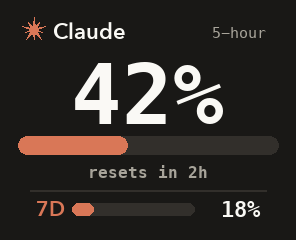
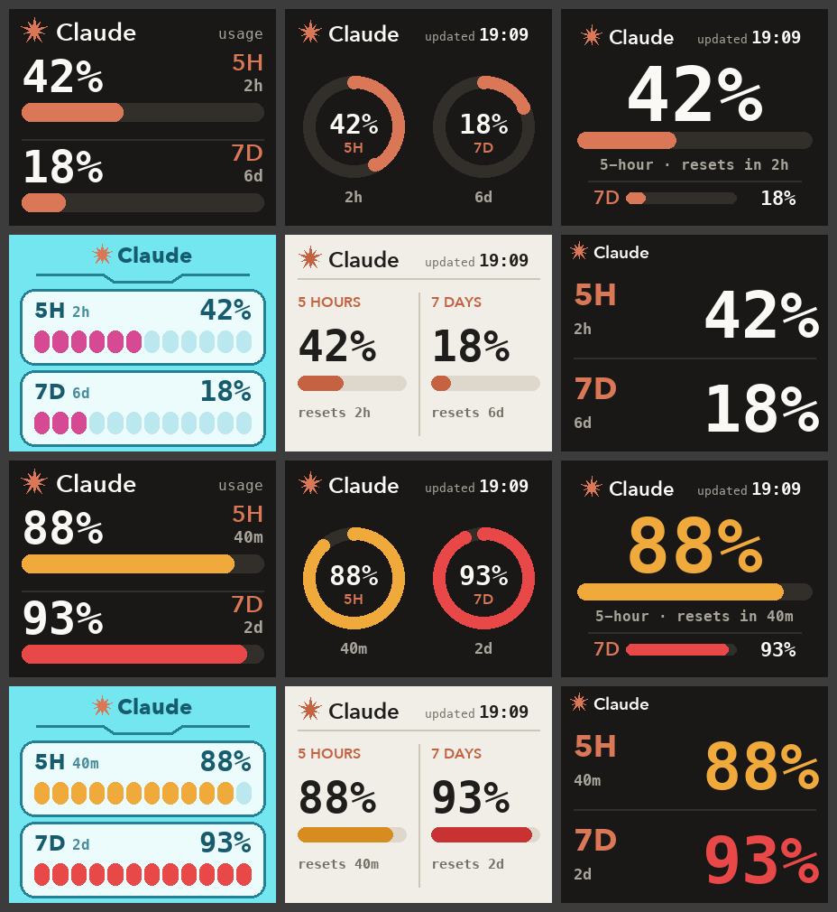

# claudecube

Show your Claude usage on the screen of a **Hatsune Miku CUBEFACE**: your 5-hour and weekly limits, the same numbers as `/usage` in Claude Code. The screen refreshes on its own every few minutes.

[ภาษาไทย](README.th.md)



- **Big number:** how much of your 5-hour limit you've used. It turns amber at 70% and red at 90%.
- **Line under the bar:** when the 5-hour window resets.
- **7D:** your weekly limit.

## What you need

- A Mac with Bluetooth
- A Hatsune Miku CUBEFACE
- Claude Code, signed in with a Claude Pro or Max account. Either the terminal or the VS Code extension works.
- Python 3. If your Mac doesn't have it, run `xcode-select --install` once.

## Install

Open Terminal and run:

```sh
git clone https://github.com/yamete-jpy/claudecube.git
cd claudecube
./claudecube.sh install
```

During install:

1. It installs two Python packages into a private folder (`.venv`). Nothing is installed system-wide.
2. It finds your cube and sends the first picture. If macOS asks whether Terminal can use Bluetooth, click **Allow**.
3. It turns on the auto-update, which runs every 5 minutes, including after a restart.

That's it. Leave the `claudecube` folder where it is, because the auto-update runs from it.

## Everyday commands

Run these from inside the `claudecube` folder:

| Command | What it does |
| --- | --- |
| `./claudecube.sh now` | Send a fresh picture right now |
| `./claudecube.sh style B` | Change the look (A to F, see below) |
| `./claudecube.sh log` | See what the auto-update has been doing |
| `./claudecube.sh find` | Look for the cube again, for example after you get a new cube |
| `./claudecube.sh connected-only on` | Update only while the cube's earbuds are connected to this Mac (`off` to undo) |
| `./claudecube.sh uninstall` | Stop the auto-update |

## Styles

Default is **C**. Change it with `./claudecube.sh style <letter>`.



| | Style | |
| --- | --- | --- |
| A | Bars | Two rows, big numbers, thick bars |
| B | Rings | Two ring gauges side by side |
| C | Session hero | The 5-hour number fills the screen (default) |
| D | Cube native | Cyan panels like the cube's own menus |
| E | Paper | Light background, two columns |
| F | Big type | Numbers only, as large as they fit |

## How it works

Every 5 minutes, macOS runs `push_face.py`:

1. **It reads your usage** from the same place Claude Code's `/usage` does. It signs in with the login Claude Code already keeps in your Mac's Keychain. That login is sent only to `api.anthropic.com`, and is never saved to a file or printed.
2. **It draws a 296×240 picture.**
3. **It sends the picture to the cube over Bluetooth**, as the cube's custom face. Your other faces are left alone. It only sends when the picture would change, so the cube's storage isn't rewritten for nothing.

## If something's wrong

| What you see | What to do |
| --- | --- |
| `cube not found` | Make sure the cube is on and near the Mac. Close the MikuCube app on your phone, since the cube talks to one device at a time. Then run `./claudecube.sh now`. |
| Bluetooth never connects | Go to System Settings → Privacy & Security → Bluetooth and allow Terminal, or whichever app you ran the install from. |
| `could not read Claude usage` | Open Claude Code once so it refreshes its login. If that doesn't work, run `/login` in Claude Code. |
| The numbers look out of date | The Mac was asleep or the cube was out of range. It catches up by itself within 5 minutes. To see why, run `./claudecube.sh log`. |
| You moved the `claudecube` folder | Run `./claudecube.sh install` again. |

## Remove it

```sh
./claudecube.sh uninstall
```

Then delete the folder. The cube keeps showing the last picture until you pick another face in the MikuCube app.

## Notes

- This is an unofficial fan project. It is not affiliated with Anthropic, Bilibili, Crypton Future Media, or the MikuCube app.
- The usage numbers come from an endpoint that Claude Code uses but Anthropic doesn't publish. It may change without notice.
- To reach the cube, this project uses its own version of the Bluetooth protocol the phone app uses (`cube_proto.py`). Use it at your own risk.
