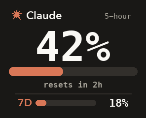
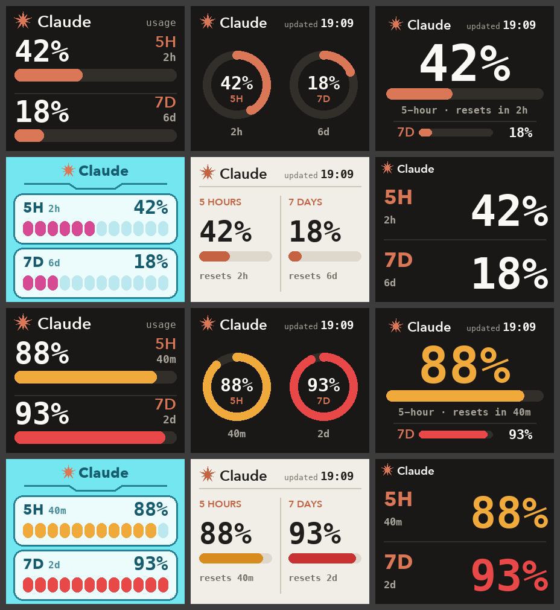

# claudecube

ให้จอ **Hatsune Miku CUBEFACE** โชว์ว่าใช้ Claude ไปเท่าไหร่แล้ว ทั้งโควต้า 5 ชั่วโมงและโควต้ารายสัปดาห์ (ตัวเลขเดียวกับ `/usage` ใน Claude Code) อัปเดตเองทุก 5 นาที

[English](README.md)



- **เลขใหญ่:** ใช้โควต้า 5 ชั่วโมงไปกี่ % แล้ว ถึง 70% จะเป็นสีส้ม ถึง 90% จะเป็นสีแดง
- **บรรทัดใต้แถบ:** อีกนานแค่ไหนโควต้า 5 ชั่วโมงจะรีเซ็ต
- **7D:** โควต้ารายสัปดาห์

## ต้องมีอะไรบ้าง

- Mac ที่มี Bluetooth
- Hatsune Miku CUBEFACE
- Claude Code ที่ล็อกอินด้วยบัญชี Claude Pro หรือ Max (ใช้ผ่าน Terminal หรือส่วนขยาย VS Code ก็ได้)
- Python 3 (ถ้ายังไม่มี ให้รัน `xcode-select --install` ครั้งเดียว)

## ติดตั้ง

เปิด Terminal แล้วรัน:

```sh
git clone https://github.com/yamete-jpy/claudecube.git
cd claudecube
./claudecube.sh install
```

ระหว่างติดตั้งจะทำ 3 อย่าง:

1. ลงแพ็กเกจ Python 2 ตัวไว้ในโฟลเดอร์ `.venv` ของโปรเจกต์ ไม่ยุ่งกับเครื่อง
2. หา cube แล้วส่งรูปแรกขึ้นไป ถ้า macOS ถามว่าให้ Terminal ใช้ Bluetooth ได้ไหม กด **Allow**
3. เปิดให้อัปเดตอัตโนมัติทุก 5 นาที (รีสตาร์ทเครื่องแล้วก็ยังทำงานต่อ)

เสร็จแล้ว ไม่ต้องทำอะไรต่อ แค่อย่าย้ายโฟลเดอร์ `claudecube` เพราะตัวอัปเดตอัตโนมัติรันจากโฟลเดอร์นี้

## คำสั่งที่ใช้บ่อย

รันในโฟลเดอร์ `claudecube`:

| คำสั่ง | ทำอะไร |
| --- | --- |
| `./claudecube.sh now` | ส่งรูปใหม่ขึ้นไปเดี๋ยวนี้ |
| `./claudecube.sh style B` | เปลี่ยนหน้าตา (A ถึง F ดูด้านล่าง) |
| `./claudecube.sh log` | ดูว่าตัวอัปเดตอัตโนมัติทำอะไรไปบ้าง |
| `./claudecube.sh find` | หา cube ใหม่ (เช่น เปลี่ยนเครื่องใหม่) |
| `./claudecube.sh connected-only on` | อัปเดตเฉพาะตอนหูฟังของ cube ต่อกับ Mac อยู่ (`off` เพื่อยกเลิก) |
| `./claudecube.sh uninstall` | หยุดอัปเดตอัตโนมัติ |

## หน้าตาให้เลือก

ค่าเริ่มต้นคือ **C** เปลี่ยนได้ด้วย `./claudecube.sh style <ตัวอักษร>`



| | แบบ | |
| --- | --- | --- |
| A | Bars | สองแถว ตัวเลขใหญ่ แถบหนา |
| B | Rings | วงแหวนสองวงคู่กัน |
| C | Session hero | เลข 5 ชั่วโมงเต็มจอ (ค่าเริ่มต้น) |
| D | Cube native | แผงสีฟ้าแบบเมนูของ cube เอง |
| E | Paper | พื้นสว่าง สองคอลัมน์ |
| F | Big type | มีแต่ตัวเลข ใหญ่เท่าที่จอจะใส่ได้ |

## ทำงานยังไง

ทุก 5 นาที macOS จะรัน `push_face.py` ซึ่งทำ 3 ขั้นตอน:

1. **อ่านตัวเลขการใช้งาน** จากที่เดียวกับที่ `/usage` ของ Claude Code อ่าน โดยใช้การล็อกอินที่ Claude Code เก็บไว้ใน Keychain ของ Mac อยู่แล้ว ข้อมูลล็อกอินนี้ส่งไปที่ `api.anthropic.com` เท่านั้น ไม่ถูกบันทึกลงไฟล์และไม่ถูกพิมพ์ออกมา
2. **วาดรูปขนาด 296×240**
3. **ส่งรูปขึ้น cube ทาง Bluetooth** เป็นหน้า custom face หน้าอื่นใน cube ไม่ถูกแตะ จะส่งเฉพาะตอนรูปเปลี่ยน หน่วยความจำของ cube จะได้ไม่ถูกเขียนซ้ำโดยไม่จำเป็น

## มีปัญหา

| เจออะไร | ทำยังไง |
| --- | --- |
| `cube not found` | เช็กว่า cube เปิดอยู่และอยู่ใกล้ Mac แล้วปิดแอป MikuCube ในมือถือ (cube คุยได้ทีละเครื่อง) จากนั้นรัน `./claudecube.sh now` |
| Bluetooth ต่อไม่ได้เลย | ไปที่ System Settings → Privacy & Security → Bluetooth แล้วอนุญาต Terminal หรือแอปที่ใช้รันตอนติดตั้ง |
| `could not read Claude usage` | เปิด Claude Code สักครั้งให้มันรีเฟรชการล็อกอิน ถ้ายังไม่หาย ให้พิมพ์ `/login` ใน Claude Code |
| ตัวเลขดูไม่อัปเดต | Mac หลับอยู่ หรือ cube อยู่ไกลเกินไป เดี๋ยวมันจะตามทันเองภายใน 5 นาที ดูสาเหตุได้ด้วย `./claudecube.sh log` |
| ย้ายโฟลเดอร์ `claudecube` ไปที่อื่น | รัน `./claudecube.sh install` ใหม่ |

## เอาออก

```sh
./claudecube.sh uninstall
```

แล้วลบโฟลเดอร์ทิ้งได้เลย cube จะยังโชว์รูปสุดท้ายค้างไว้จนกว่าจะเลือกหน้าอื่นในแอป MikuCube

## หมายเหตุ

- โปรเจกต์นี้เป็นโปรเจกต์แฟนเมดที่ไม่เป็นทางการ ไม่เกี่ยวข้องกับ Anthropic, Bilibili, Crypton Future Media หรือแอป MikuCube
- ตัวเลขการใช้งานมาจาก endpoint ที่ Claude Code ใช้แต่ Anthropic ไม่ได้เปิดเผยเป็นทางการ อาจเปลี่ยนได้โดยไม่แจ้ง
- การคุยกับ cube ใช้โปรโตคอล Bluetooth ที่เขียนขึ้นใหม่ให้เหมือนแอปมือถือ (`cube_proto.py`) ใช้งานตามความเสี่ยงของตัวเอง
